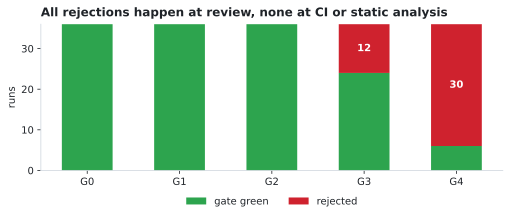
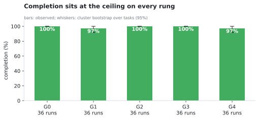
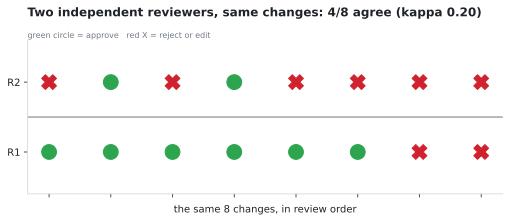
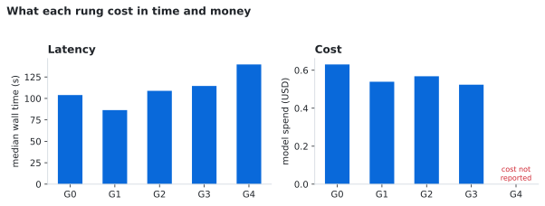

# Foreman

**What guardrails cost, and what they buy, in agentic software delivery.**

[](https://github.com/RealNarcissus/Foreman/actions/workflows/ci.yml)
[](LICENSE)
[](https://www.python.org)

A coding agent solves a fixed task suite under progressively stricter delivery
gates — CI, static analysis, automated review, human review. The harness measures
completion, latency, cost and **gate escapes**: changes a gate accepted that are
still wrong.

The pipeline is not the deliverable. The measurement is.



> **The pilot is complete: 180 runs**, 5 rungs × 12 tasks × k=3, plus a human
> rung reviewed by two independent reviewers. Descriptive only — one repository,
> one worker, and intervals wide by construction. Full numbers in
> [docs/12-results.md](docs/12-results.md).

## Findings

**1. Completion is at the ceiling and cannot discriminate.** Every rung sits
within one case of 36/36. A flat curve here means *uninformative*, not that gates
do nothing.



**2. Zero gate escapes in 180 runs** — 95% upper bound ≈ 1.7%. No change passed a
gate and then failed its oracle.

**3. All the yield is rejection, and all of it comes from review.** 12 rejections
at G3 and 30 at G4, against none at G0–G2. Static analysis rejected nothing on
this task set — consistent with the pre-check below.

**4. Two independent reviewers disagreed on half the changes they both saw.**
Same 8 changes: 25% versus 75% interventions, 50% agreement, inter-rater
kappa 0.20. Human yield is a range that depends on *who* reviews.



**5. The gate you get by pressing the button cannot see a library's inputs.** In
the pre-check, four planted probes produced zero CodeQL alerts in GitHub's
default configuration; protocol analysis and extended suites recover 2 of 4 but
do not fix the blind spot. This result stands independently of the sweep — see
[docs/04-g2-precheck.md](docs/04-g2-precheck.md).

## What it costs



Model spend for the whole sweep was **$2.26**. G4 cost is missing, not zero: the
provider returned `cost: 0` with non-zero token counts on every step, and it is
not imputed.

## The ladder

| Rung | Treatment | Runs | Complete | Gate green | Rejected |
| --- | --- | --- | --- | --- | --- |
| G0 | nothing | 36 | 36 | 36 | 0 |
| G1 | project CI | 36 | 35¹ | 36 | 0 |
| G2 | CI + CodeQL, frozen config | 36 | 36 | 36 | 0 |
| G3 | G2 + frozen automated review | 36 | 36 | 24 | 12 |
| G4 | G3 + human review | 36 | 35 | 6 | 30 |

¹ excluded by containment: the worker searched for the benchmark online. Kept in
the ledger with its reason; not a capability failure.

## Quickstart

```bash
python3 -m harness.cli selfcheck      # 4 containment controls, no model spend
python3 tools/verify_tasks.py         # every oracle fails on seed, passes on reference
python3 tools/analyze.py              # regenerate every number in the results
python3 tools/make_figures.py         # regenerate the figures above
```

Requirements: Python 3.11+, `bwrap`, `opencode` with a provider credential, and
optionally CodeQL for G2 and above. The subject is `pallets/click` at commit
`8b19813`, checked out by default at `/tmp/click_tag`.

A full rung takes about 30 minutes at concurrency 4:

```bash
FOREMAN_CODEQL=$HOME/.codeql/codeql/codeql FOREMAN_CODEQL_ENABLE=1 \
  python3 tools/sweep.py --rungs G0,G1,G2,G3 --concurrency 4
```

## Repository layout

```
configs/rungs/   G0..G4 as data — the treatment is a file, not a branch
tasks/           task suite: specs, seeds, references, hidden oracles
harness/         runner, sandbox, gates, reviewer, oracle, ledger writer
tools/           verification, sweep, re-gate, analysis, figures, review console
ledger/          run ledger, human decisions, archived diagnostics
docs/            preregistration, pre-checks, results, protocols, figures
```

## How it stays honest

- **Split gate from oracle.** The gate decides rung behaviour; a hidden oracle
  decides truth, out of band, never inside the worktree.
- **Fail closed.** A gate that cannot run fails; a reviewer without a pinned
  prompt refuses; a malformed model response is an error, never an approval.
- **One treatment, one file.** Rung behaviour is data; changing it is a diff.
- **Everything regenerable.** Ledger → analysis → figures, one command each.

Four separate times, this project found a plausible-looking configuration that
silently disabled the thing it named — a UI label used as a threat model, a
skipped static-analysis gate reporting success, a reviewer that was never pinned,
and a ledger writer that grew a second header. Each is documented where it was
found; they are the reason the fail-closed rules exist.

## Validity

One repository, one worker, k=3 per cell. Repeated runs of a task are not
independent observations, so intervals resample tasks, not runs. Two reviewers is
not a sample of reviewers. Nothing here shows that guardrails do not work: it
measures what this ladder cost and bought on this task set, and one of its gates
proved unstable enough that its yield is reported as a range.

## Documentation

| Document | Purpose |
| --- | --- |
| [00-scope](docs/00-scope.md) | Problem, research questions, design, milestones, kill criteria |
| [01-lit-check](docs/01-lit-check.md) | Literature check and novelty criteria |
| [02-preregistration](docs/02-preregistration.md) | Pre-registered design, hypotheses, analysis plan, scope note |
| [03-subject-repo](docs/03-subject-repo.md) | Subject selection |
| [04-g2-precheck](docs/04-g2-precheck.md) | The CodeQL finding |
| [05-run-configuration](docs/05-run-configuration.md) | Worker and reviewer configuration |
| [06-m2-containment](docs/06-m2-containment.md), [07-containment-controls](docs/07-containment-controls.md) | Containment failure, root cause, and controls |
| [07-m2-result](docs/07-m2-result.md) | Worker selection |
| [08-saturation-check](docs/08-saturation-check.md), [09-revision-saturation-check](docs/09-revision-saturation-check.md) | Saturation diagnostics and the hardening revision |
| [10-m3-sweep](docs/10-m3-sweep.md) | Sweep record, including the G2 configuration defect |
| [11-g4-protocol](docs/11-g4-protocol.md) | Human-review protocol |
| [12-results](docs/12-results.md) | **All numbers, intervals and limitations** |
| [adr/0001](docs/adr/0001-guardrail-ablation-not-agent-benchmark.md) | Why this is an ablation, not a leaderboard |

## Citation

Cite via [CITATION.cff](CITATION.cff).

## License

MIT — see [LICENSE](LICENSE).
